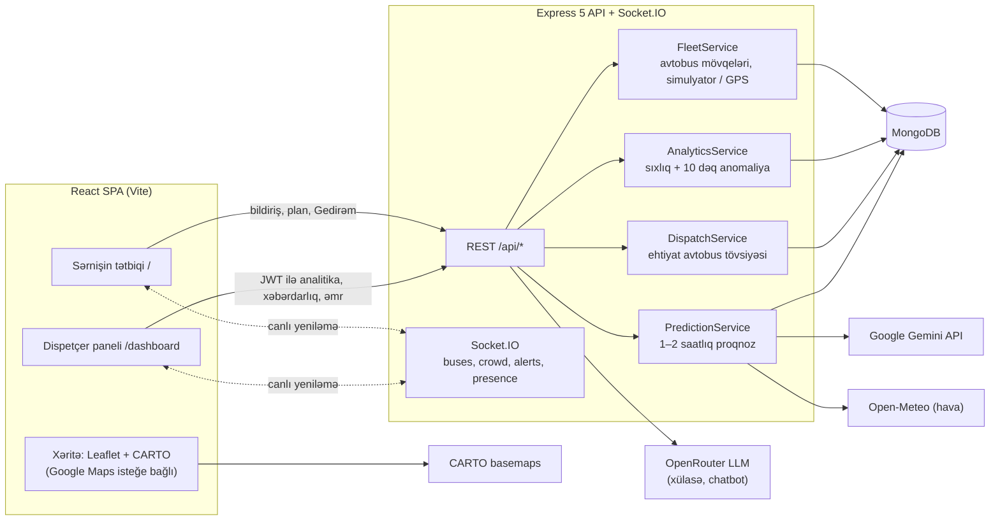
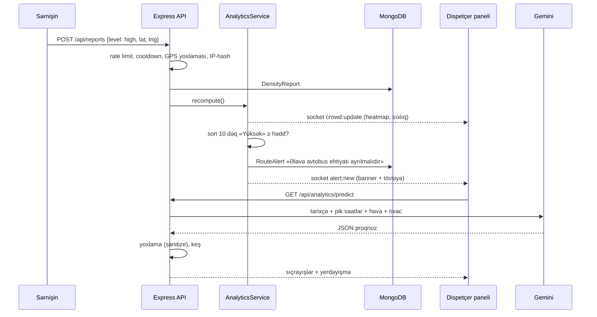

# Sistem arxitekturası

Smart Transit Bakı üç qatdan ibarətdir: brauzerdə işləyən **React SPA**, **Express REST API + Socket.IO** serveri və **MongoDB** bazası. Xarici xidmətlər (CARTO, Gemini, Open-Meteo və isteğe bağlı Google / OpenRouter) yalnız server və ya xəritə qatı üzərindən çağırılır.

## 1. Frontend — React SPA (`client-react/`)

| Hissə | Texnologiya | Vəzifə |
|---|---|---|
| UI | React 19, Vite 8, Tailwind CSS 4 (CSS tokenləri) | «Six-O» dizayn sistemi, işıqlı / qaranlıq tema |
| Data | Redux Toolkit + RTK Query | API sorğuları, keş, dil dəyişəndə lokallaşdırılmış keşin yenilənməsi |
| Real vaxt | `socket.io-client` | avtobus mövqeləri, sıxlıq, xəbərdarlıqlar, canlı lokasiya |
| Xəritə | Leaflet + CARTO plitələri; açar olduqda `@vis.gl/react-google-maps` | avtobuslar, xətlər, sıxlıq heatmap-i |
| Dil | i18next (AZ / EN / RU) | interfeys mətnləri, cəm formaları |
| Marşrutlar | react-router | `/` sərnişin, `/login`, `/dashboard/*` (operator / admin) |

İki modul var:

- **Sərnişin** (`/`): Haradan → Haraya planlayıcı, canlı avtobuslar və gəliş vaxtı, sıxlıq bildirişi (Az / Orta / Yüksək), «Gedirəm», canlı lokasiya paylaşımı, chatbot.
- **Dispetçer paneli** (`/dashboard`): xəritə + sağ panel (aktiv xəbərdarlıqlar, **Gemini proqnozu**, xətlər, canlı və proaktiv tələb), xətt konteksti, tövsiyə və əmr göndərmə, hesabatlar.

## 2. Backend — Express REST API (`server/`)

Node.js 22, Express 5, ESM modulları və `#` import alias-ları (`#services`, `#models`, …).

| Qat | Qovluq | Vəzifə |
|---|---|---|
| Giriş nöqtəsi | `app.js`, `core/createApp.js` | env yoxlaması, middleware-lər, route-lar, Socket.IO, servislərin işə salınması |
| Route-lar | `routes/` | `/api/routes`, `/reports`, `/analytics`, `/alerts`, `/plan`, `/intents`, `/demand`, `/density`, `/dispatch`, `/ai`, `/auth`, `/demo` |
| Controller-lər | `controllers/` | sorğunun yoxlanması, servis çağırışı, `{ success, data }` cavabı |
| Servislər | `services/` | domen məntiqi (aşağıda) |
| Middleware | `middlewares/` | JWT auth + rol, helmet, CORS, rate limit-lər, NoSQL / prototip sanitizer, dil (`Accept-Language`) |
| Lokallaşdırma | `locales/` | server mesajları AZ / EN / RU |

Əsas servislər:

| Servis | Nə edir |
|---|---|
| `FleetService` | xətlərin həndəsəsi, avtobusların yaddaşda vəziyyəti, simulyator və ya real GPS (`POST /api/routes/buses/:id/location`) |
| `EtaService` | dayanacağa gəliş vaxtı və interval |
| `AnalyticsService` | bildirişlərdən xətt / avtobus / seqment sıxlığı; 10 dəqiqə «Yüksək» → `RouteAlert` «Əlavə avtobus ehtiyatı ayrılmalıdır» |
| `ForecastService` | həftə günü × saat üzrə statistik proqnoz |
| `PredictionService` + `GeminiService` + `WeatherService` | 1–2 saatlıq proqnoz: tarixçə, pik saatlar, hava, tıxac → Gemini → yoxlanmış JSON |
| `DemandService`, `PresenceService` | «Gedirəm» niyyətləri (proaktiv tələb) və anonim canlı lokasiya |
| `DispatchService`, `AssistantService` | ehtiyat avtobus formulu, əmr şablonları, AI izahı və chatbot |
| `PlannerService` | dayanacaqlar qrafı üzərində köçürməli marşrut planı |

## 3. Verilənlər bazası — MongoDB (Mongoose)

| Kolleksiya | Əsas sahələr | İndekslər / TTL |
|---|---|---|
| `routes` | `number`, `name`, `color`, `stops[{name, lat, lng}]`, `path[[lat, lng]]` | `number` unikal |
| `buses` | `route`, `plate`, `lat`, `lng`, `distance`, `direction`, `isReserve` | `route + active` |
| `densityreports` | `route`, `bus`, `level (low/mid/high)`, `location (GeoJSON)`, `verified`, `deviceId`, `ipHash` | `route + createdAt`, `2dsphere`, **30 gün TTL** |
| `routealerts` | `route`, `type`, `status (open/acknowledged/dispatched/resolved)`, `stats`, `recommendation`, `history[]`, `reserveBuses` | `route + type + status` |
| `tripintents` | `deviceId`, `status`, `origin`, `destination`, `board{route, stop}`, `expiresAt` | `2dsphere`, **TTL** |
| `densitysnapshots` | dəqiqəlik anonim aqreqat: `cells`, `stops.waiting`, `buses.riders` | **7 gün TTL** |
| `dispatchcommands` | `route`, `alert`, `type`, `text`, `source (manual/ai)`, `issuedBy` | `route + createdAt` |
| `users`, `otps` | rol (`user` / `operator` / `admin`), parol hash-i, token versiyası | `role`, `status` |

Şəxsi məlumat minimumdur: IP saxlanılmır (yalnız HMAC hash-i), canlı lokasiya fərdi koordinat kimi yox, hücrə aqreqatı kimi yazılır.

## 4. Xarici API-lər

| Xidmət | Harada | Nə üçün | Olmasa |
|---|---|---|---|
| **CARTO basemaps** | brauzer (Leaflet) | işıqlı (Voyager) və qaranlıq (Dark Matter) xəritə plitələri | açarsız CARTO / OSM |
| **Google Gemini** | server (`GeminiService`) | 1–2 saatlıq sıxlıq proqnozu və yerdəyişmə tövsiyəsi, strukturlu JSON | deterministik baza modeli |
| **Open-Meteo** | server (`WeatherService`) | yağış, külək, temperatur, növbəti 2 saatın yağış ehtimalı (açarsız) | proqnoz havasız hesablanır |
| OpenRouter | server (`AIService`) | operator xülasəsi, tövsiyə izahı, chatbot | qayda əsaslı mətnlər |
| Google Maps / Places / Routes | brauzer + server | xəritə, ünvan axtarışı, transit alternativləri | Leaflet + Photon (OSM) + daxili planlayıcı |

## 5. Əsas axın: bildirişdən xəbərdarlığa və proqnoza

